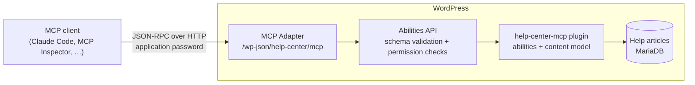
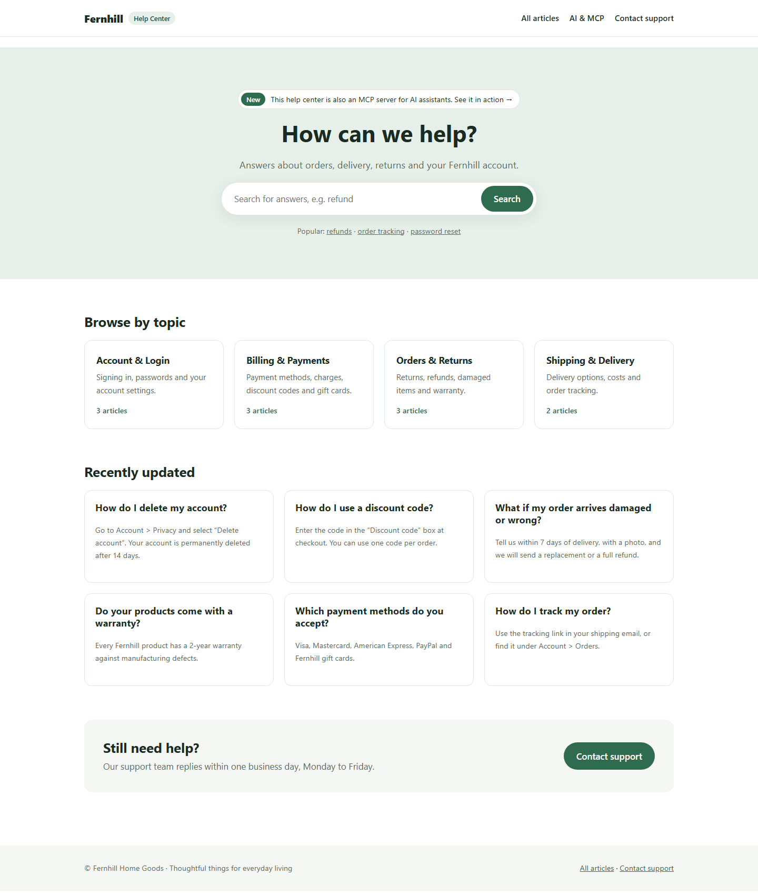
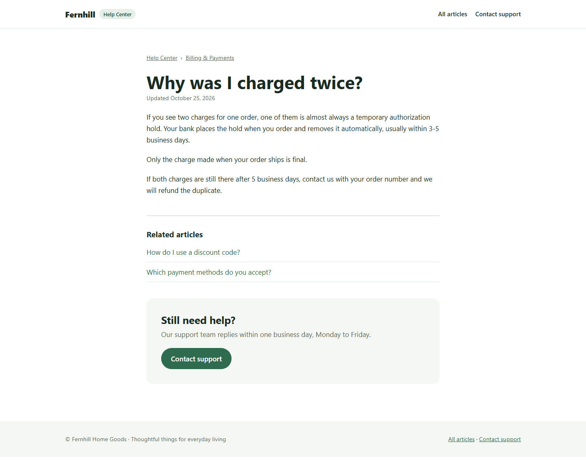

# Help Center MCP


A WordPress plugin that turns a help center into a [Model Context Protocol](https://modelcontextprotocol.io) (MCP) server. AI assistants such as Claude, or any other MCP client, can search and read support articles and draft new ones, and WordPress's own permission system decides what they're allowed to do.

It runs the help center of **Fernhill**, a small online home-goods store. Customers browse and search the articles on the website, and the support team's AI assistant works with the same articles through MCP.

> **You:** A customer writes: "I see two charges for one order. What's going on?"
>
> **Assistant:** *searches the help center → reads "Why was I charged twice?"* One of the charges is a temporary authorization hold that the bank removes within 3–5 business days… ([source](http://localhost:8888/help/charged-twice/))
>
> **You:** Can customers cancel an order after placing it?
>
> **Assistant:** The help center doesn't cover that, so I won't guess. Want me to draft an article? *→ creates a draft that an editor reviews in wp-admin*

## How it works



- **The plugin** registers a *Help Article* post type, a *Topic* taxonomy and six **abilities** with the [WordPress Abilities API](https://developer.wordpress.org/news/2025/11/introducing-the-wordpress-abilities-api/) (WordPress 6.9+). Each ability declares a description, JSON Schemas for input and output, a permission callback and an execute callback.
- **The [MCP Adapter](https://github.com/WordPress/mcp-adapter)**, the official WordPress plugin for MCP, speaks the protocol. `mcp-server.php` tells it which abilities to expose as MCP tools, resources and prompts, and who may connect.
- **WordPress enforces everything:** input is validated against the schema and permissions are checked before any callback runs, so the model is never trusted to behave.
- **The Fernhill theme**, a block theme, presents the help center to customers. The plugin owns the data and the AI access; the theme only decides how things look.

## The website



- **Home:** a "How can we help?" search, cards for each topic with their article counts, recently updated articles, and a way to contact support.
- **Article pages:** breadcrumbs, the date of the last update, related articles from the same topic.
- **Topic pages and All articles:** article lists, sorted A–Z.
- **Search:** covers help articles only, and suggests contacting support when nothing matches.
- **Contact support:** email address, opening hours and what to have ready.
- **AI & MCP:** the MCP server at work, from the website itself: the tools, resource and prompt it offers, and a console that sends real requests to it. The home page links to it from a "New" announcement.

When the assistant drafts a new article and an editor publishes it, it appears on the site like any other article.



## What the server offers

| MCP type | Name | What it does | Who may use it |
| --- | --- | --- | --- |
| Tool | `help-center-search-articles` | Keyword search over published articles | Anyone (read-only) |
| Tool | `help-center-get-article` | Full text of one article | Published: anyone. Unpublished: users who can edit it |
| Tool | `help-center-list-topics` | Topics with their slugs, links and article counts | Anyone (read-only) |
| Tool | `help-center-create-draft` | Saves a new article **as a draft only** | `edit_posts` |
| Resource | `help-center://style-guide` | Writing rules the assistant follows when drafting | `edit_posts` |
| Prompt | `help-center-answer-customer-question` | Template: answer from the help center, link sources, offer a draft if it's missing | `read` |

Tools carry MCP annotations (`readOnlyHint`, `destructiveHint`, `idempotentHint`), so clients can treat read-only tools differently from ones that write. Tool results include both text and `structuredContent` that matches the output schema.

## Security model

- **Two permission layers.** The whole server requires `edit_posts`, and each ability then runs its own check, for example per post for unpublished articles.
- **Least privilege.** The assistant signs in as a dedicated *AI Assistant* user with the **Contributor** role, using an [application password](https://make.wordpress.org/core/2020/11/05/application-passwords-integration-guide/). It can write drafts but can't publish, edit other people's content or delete anything. You can revoke the password at any time under *Users → Profile*.
- **Human in the loop.** `create-draft` always saves with status `draft`, whatever the user's role. Publishing stays a human decision. The style guide also tells the assistant to mark unconfirmed facts as `[CHECK: …]` for the editor.
- **Validated input and output.** WordPress checks every argument against the JSON Schema (types, lengths, required fields, no unknown properties) before the callback runs, and checks the result against the output schema afterwards.
- **No markup injection.** Text from the assistant is HTML-escaped and converted into editor blocks, so a prompt-injected draft can't plant scripts or markup.
- **Errors the model can act on.** Failures come back as tool results with `isError: true` and a next step, for example *"Unknown topic "nope". Use one of: account, billing, orders, shipping."*. The model can correct itself instead of failing.

## Protocol support

Through the MCP Adapter (v0.7.1) the server supports both current MCP revisions:

- **2025-11-25:** session-based. The client sends `initialize`, then reuses the `Mcp-Session-Id` header.
- **2026-07-28:** stateless. There's no handshake: every request carries its protocol version in `_meta`, and `server/discover` advertises what the server supports.

Two transports are available:

- **Streamable HTTP**, at `/wp-json/help-center/mcp` through the WordPress REST API.
- **STDIO**, through WP-CLI (`wp mcp-adapter serve`).

## Quick start

Requirements: Docker Desktop.

```bash
docker compose up -d
docker compose run --rm cli sh /project/setup/setup.sh
```

> In Git Bash on Windows, prefix the second command with `MSYS_NO_PATHCONV=1` so Git Bash doesn't rewrite `/project/...` into a Windows path.

The setup script is safe to re-run. It installs WordPress, the MCP Adapter, this plugin and the Fernhill theme, and adds the help articles and the Contact page. It also creates the *AI Assistant* user and, on the first run, writes `.mcp.json` with an application password. That file is git-ignored. Later runs keep the same password, so connected clients stay connected. To issue a new one, run `docker compose run --rm -e RESET_MCP_PASSWORD=1 cli sh /project/setup/setup.sh`.

To delete everything the AI assistant has written and get back to the sample articles (the password stays the same):

```bash
docker compose run --rm cli sh /project/setup/reset.sh
```

| What | Where |
| --- | --- |
| Help center | <http://localhost:8888/> |
| Admin | <http://localhost:8888/wp-admin> (`admin` / `password`; change it before [deploying](#deployment)) |
| MCP endpoint | `http://localhost:8888/wp-json/help-center/mcp` |

### Connect Claude Code

Open this folder in Claude Code and approve the `help-center` server from `.mcp.json`:

```json
{
  "mcpServers": {
    "help-center": {
      "type": "http",
      "url": "http://localhost:8888/wp-json/help-center/mcp",
      "headers": { "Authorization": "Basic <base64 of ai-assistant:application-password>" }
    }
  }
}
```

### Explore with the MCP Inspector

```bash
npx @modelcontextprotocol/inspector@latest --config .mcp.json
```

The Inspector reads the same `.mcp.json` as Claude Code, so there's nothing to copy. Switch the `help-center` server on, then list and call tools, read the resource and fill in the prompt. The **Protocol** panel shows every JSON-RPC message.

### Talk to it over STDIO

`examples/stdio-session.jsonl` holds exactly what an MCP client sends: the handshake, `tools/list` and one `tools/call`. Pipe it into the STDIO server:

```bash
docker compose run --rm -T cli sh -c "wp mcp-adapter serve --server=help-center --user=ai-assistant < /project/examples/stdio-session.jsonl"
```

### The AI & MCP page

<http://localhost:8888/ai/> shows website visitors the MCP side of the help center:

- **What assistants can use:** the tools, resource and prompt, read live from `tools/list`, `resources/list` and `prompts/list`.
- **A recorded session:** Claude answering two customer questions, step by step, with the exact MCP messages behind each step.
- **A live MCP console:** visitors send real requests and see both sides of the exchange. It runs the site's MCP server in-process (`rest_do_request()`, stateless 2026-07-28 revision) as a `website-demo` Contributor account that owns no posts, so it only ever sees published articles. Only tools marked read-only can run, and requests are rate limited.

To show a "Read the code on GitHub" button, set the repository URL:

```bash
docker compose run --rm cli wp option update help_center_github_url https://github.com/<you>/<repo>
```

**Optional live assistant.** With an Anthropic API key, the page also lets visitors ask a question and watch Claude answer it through the MCP server: the plugin reads the tools and the answer prompt over MCP, gives Claude the read-only tools, and runs each tool call as `tools/call`. It uses the official Anthropic PHP SDK and `claude-opus-5-5` (change it with `HELP_CENTER_ASSISTANT_MODEL` in `wp-config.php`). A paid claude.ai plan doesn't include API access: create a key in the [Claude Console](https://platform.claude.com/), then:

```bash
docker compose run --rm composer install          # installs the SDK into plugins/help-center-mcp/vendor
echo "ANTHROPIC_API_KEY=sk-ant-..." > .env         # git-ignored
docker compose up -d                               # restarts WordPress with the key
```

Every question costs API credits and anyone who can open the page can ask, so the endpoint allows 5 questions per visitor per 10 minutes and 100 per day in total. Without a key, the page shows only the recorded session.

## Deployment

WordPress needs a PHP server, a MySQL/MariaDB database and a disk that keeps its files. Serverless platforms such as Vercel or Netlify offer none of these, so they can't run this project. Any machine that runs Docker can.

Docker Compose reads its settings from a `.env` file next to `docker-compose.yml`. The file is git-ignored, and the defaults suit a local site:

| Variable | Default | Purpose |
| --- | --- | --- |
| `SITE_URL` | `http://localhost:8888` | The site's public address. `setup.sh` saves it as the WordPress home and site URL, and writes it into a new `.mcp.json`. |
| `ADMIN_PASSWORD` | `password` | Password for the `admin` user. It only takes effect on the first install. |
| `HTTP_PORT` | `8888` | The host port WordPress listens on. Use `127.0.0.1:8888` behind a reverse proxy. |
| `WORDPRESS_DEBUG` | `1` | Set to `0` on a public site, so `wp-content/debug.log` isn't written. |
| `WP_ENVIRONMENT_TYPE` | `local` | Set to `production` on a server with HTTPS. Keep `local` when tunnelling, so local MCP clients can still connect over `http://localhost`. |
| `ANTHROPIC_API_KEY` | (empty) | Optional. Turns on the live assistant on the AI & MCP page. |

After changing `.env`, run `docker compose up -d` and then the setup script again.

### Option 1: share your local site through a tunnel

This is the quickest way to get a public HTTPS link. The site keeps running on your computer, so it's only online while the computer and Docker are running. With [Tailscale Funnel](https://tailscale.com/kb/1223/funnel):

```bash
tailscale funnel --bg 8888        # prints https://<machine>.<tailnet>.ts.net
```

Add the printed address to `.env`, together with `WORDPRESS_DEBUG=0`:

```bash
SITE_URL=https://<machine>.<tailnet>.ts.net
WORDPRESS_DEBUG=0
```

Then apply the settings and replace the default admin password. The site is already installed, so `ADMIN_PASSWORD` doesn't apply here:

```bash
docker compose up -d
docker compose run --rm cli sh /project/setup/setup.sh
docker compose run --rm cli wp user update admin --user_pass='<a strong password>'
```

To take the site offline again, run `tailscale funnel reset`, remove `SITE_URL` from `.env` and run the setup script again.

### Option 2: a server with Docker

A small Linux VPS with 1 GB of RAM is enough. Point a DNS record such as `help.example.com` at the server, install Docker and [Caddy](https://caddyserver.com/docs/install), and run:

```bash
git clone https://github.com/<you>/<repo>.git help-center && cd help-center
cat > .env <<'EOF'
SITE_URL=https://help.example.com
ADMIN_PASSWORD=<a strong password>
HTTP_PORT=127.0.0.1:8888
WORDPRESS_DEBUG=0
WP_ENVIRONMENT_TYPE=production
EOF
docker compose up -d
docker compose run --rm cli sh /project/setup/setup.sh
```

Caddy handles HTTPS and renews the certificate automatically. Put this in `/etc/caddy/Caddyfile`, then run `sudo systemctl reload caddy`:

```text
help.example.com {
	reverse_proxy 127.0.0.1:8888
}
```

The WordPress Docker image trusts the proxy's `X-Forwarded-Proto` header, so WordPress knows the visitor used HTTPS.

- **MCP clients:** the setup script writes a `.mcp.json` on the server with the public endpoint and the AI assistant's credentials. Copy it to the computer that runs your MCP client, and keep it private.
- **Live assistant:** add `ANTHROPIC_API_KEY` to `.env`, then run `docker compose run --rm composer install` and `docker compose up -d`.
- **Updates:** run `git pull`. The plugin and theme folders are mounted into the container, so changes go live straight away.
- **Backups:** run `docker compose run --rm cli wp db export /project/backup.sql`.

### Option 3: an existing WordPress site

The plugin works on any host with WordPress 6.9+ and PHP 8.1+:

1. Install and activate the [MCP Adapter](https://github.com/WordPress/mcp-adapter/releases) from its release zip (*Plugins → Add New → Upload Plugin*).
2. Zip `plugins/help-center-mcp` and upload it the same way. If you want the live assistant, include `vendor/`. Optionally, zip `themes/fernhill` and upload it under *Appearance → Themes*.
3. Under *Settings → Permalinks*, choose *Post name*.
4. Add content: run `wp eval-file setup/seed.php` if the host has WP-CLI, or write articles in wp-admin.
5. Create an `ai-assistant` user with the **Contributor** role, and give it an application password under *Users → Profile*. MCP clients send `Authorization: Basic <base64 of ai-assistant:application-password>`.
6. For the live assistant, add `define( 'HELP_CENTER_ANTHROPIC_API_KEY', 'sk-ant-...' );` to `wp-config.php`.

### Before you make it public

- Use a strong admin password. This README publishes the default.
- Turn debugging off (`WORDPRESS_DEBUG=0`). Otherwise anyone can download `wp-content/debug.log`.
- If you set an API key, also set a monthly spend limit in the Claude Console. The rate limits keep costs down, but any visitor can spend your credits.

## Project structure

```text
plugins/help-center-mcp/
├── help-center-mcp.php          Plugin header, bootstrap, activation hooks
├── composer.json                Optional: the Anthropic PHP SDK for the live assistant
├── assets/                      Script, styles and recorded session for the AI & MCP page
└── includes/
    ├── content-model.php        Help Article post type, Topic taxonomy, text ↔ block helpers
    ├── abilities.php            The abilities: schemas, permission checks, callbacks
    ├── mcp-server.php           Which abilities MCP clients see, and who may connect
    ├── mcp-client.php           In-process MCP client the website uses to call its own server
    ├── showcase.php             The AI & MCP page: [help_center_ai_showcase], live console
    └── assistant.php            Optional live assistant: Claude + the MCP server's tools
themes/fernhill/                 Block theme: theme.json, templates, header/footer parts,
                                 topic cards, breadcrumbs and related articles
setup/
├── setup.sh                     One-command local setup (runs in the WP-CLI container)
├── seed.php                     Help topics, articles and the Contact page
└── reset.sh                     Deletes the articles the AI assistant wrote
examples/stdio-session.jsonl     A raw MCP session, line by line
docs/screenshots/                Screenshots used in this README
docker-compose.yml               WordPress 7.1, MariaDB 11.4, WP-CLI
```

## Design decisions

- **Abilities API + MCP Adapter instead of a standalone MCP server.** Validation, permissions and data access live in one place, inside WordPress. The same abilities can serve other clients too, through REST or JavaScript. This is also the approach the WordPress project itself recommends for AI integrations.
- **A few task-shaped tools instead of generic CRUD.** Four specific tools are easier for a model to use correctly, and safer, than a general "update any post" endpoint.
- **Descriptions written for the model.** Tool descriptions say *when* to use each tool and *how*: keyword search tips, formatting rules for drafts, and where IDs and topic slugs come from. The model only knows a tool through its name, description and schema.
- **Plugin for behaviour, theme for presentation.** The post type, abilities and MCP server live in the plugin, so the help center and its AI access keep working with any theme.
- **Each primitive used for its intended job.** Tools are actions the model decides on. The style guide is a resource: context the application loads. The answer workflow is a prompt: a template the user starts.

## Ideas for next steps

- Record questions the help center couldn't answer, as a content-gap report for editors.
- Semantic (embedding) search alongside keyword search.
- OAuth 2.1 instead of application passwords, for remote clients.
- PHPUnit tests for the abilities, plus an observability handler that keeps an audit log of AI actions.

## License

GPL-2.0-or-later
